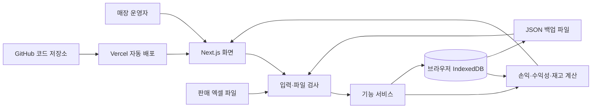

# 프렙 카페 운영 관리 프로그램 기술 요구사항 문서(TRD)

- 문서 상태: 1차 기술 설계 확정
- 작성일: 2026-10-12
- 기준 문서: `docs/01_PRD.md`, `docs/02_FRD.md`
- 참고 시안: `design/_1`~`design/_4`, `design/apex_operations/DESIGN.md`
- 코드 보관: GitHub 저장소
- 배포 대상: Vercel
- 구현 범위: 단일 운영자·단일 기기용 4시간 MVP

## 1. 기술 설계 목표

이 프로그램은 카페 운영자가 한 기기의 웹브라우저에서 판매·비용·재고 기록을 관리하고, 실적·수익성·손익·재고를 확인하는 웹앱으로 만든다.

기술 설계의 우선순위는 다음과 같다.

1. PRD와 FRD의 계산 기준과 사용 순서를 그대로 구현한다.
2. 매장 자료를 외부 서버에 전송하지 않고 사용자의 브라우저 안에 저장한다.
3. 판매 입력부터 수익성·손익·재고 반영까지 한 번의 저장으로 일관되게 갱신한다.
4. 엑셀 가져오기와 백업 복원이 실패해도 기존 자료가 일부만 바뀌지 않게 한다.
5. GitHub에 코드를 보관하고 Vercel에서 자동으로 검사·배포한다.
6. 4시간 MVP에 맞춰 로그인, 서버, 클라우드 데이터베이스, 외부 연동을 만들지 않는다.

## 2. 최종 기술 선택

| 구분 | 선택 기술 | 선택 이유 |
|---|---|---|
| 웹앱 | Next.js 16.2 계열 최신 안정 패치, App Router | 화면 경로와 공통 레이아웃을 단순하게 구성하고 Vercel 배포가 쉬움 |
| 개발 언어 | TypeScript 엄격 모드 | 날짜·금액·수량·기록 유형을 잘못 섞는 오류를 개발 중에 발견하기 쉬움 |
| 실행 환경 | Node.js 24 LTS, pnpm | Vercel의 현재 기본 지원 버전과 맞추고 잠금 파일로 의존성을 고정함 |
| 화면 구성 | React, Tailwind CSS, CSS 변수 | 시안의 Tailwind 기반 구조와 디자인 토큰을 재사용하기 쉬움 |
| 브라우저 저장소 | IndexedDB, Dexie 4 | 수천 건의 구조화된 자료를 브라우저에 저장하고 여러 자료를 한 번에 안전하게 변경할 수 있음 |
| 입력 검사 | Zod | JSON·폼·엑셀·백업 파일을 같은 규칙으로 검사할 수 있음 |
| 폼 처리 | React Hook Form | 판매·비용·재고 입력의 오류 표시와 저장 상태를 단순하게 관리함 |
| 금액 계산 | decimal.js | 자바스크립트 소수 계산 오차를 피하고 FRD의 반올림 기준을 지킬 수 있음 |
| 날짜 계산 | date-fns | 월요일 시작 주간과 달력 기준 월·분기·반기·연간 경계를 일관되게 처리함 |
| 엑셀 | ExcelJS 브라우저 빌드 | `.xlsx` 판매 양식 생성과 읽기를 브라우저 안에서 처리할 수 있음 |
| 단위 검사 | Vitest | 손익·원가·재고 계산을 빠르게 반복 검사함 |
| 화면 흐름 검사 | Playwright | 판매 입력부터 백업 복원까지 실제 브라우저 흐름을 확인함 |
| 코드 품질 | ESLint, TypeScript 검사 | 배포 전 문법·타입 오류를 차단함 |
| 배포 | Next.js 정적 내보내기, Vercel | 실행 서버 없이 HTML·CSS·JavaScript 파일만 배포해 비용과 장애 지점을 줄임 |

버전은 `package.json`과 `pnpm-lock.yaml`에 고정한다. 개발 중 임의로 최신 버전으로 올라가지 않으며, 보안 또는 배포 호환성 문제가 있을 때만 검사를 거쳐 갱신한다.

## 3. 전체 구조



Vercel은 프로그램 파일만 제공한다. 판매·비용·재고·백업 내용은 Vercel 서버나 GitHub로 보내지 않는다.

## 4. 배포 방식

### 4.1 정적 웹앱

- `next.config.ts`에서 `output: 'export'`를 사용한다.
- 모든 기록 읽기·쓰기·계산·엑셀·백업 처리는 브라우저에서 수행한다.
- Vercel Function, Server Action, API 경로, 서버 세션, 쿠키를 사용하지 않는다.
- 빌드 결과는 정적 HTML·CSS·JavaScript이며 Vercel의 CDN에서 제공한다.
- 브라우저 전용 API인 IndexedDB와 File API는 Client Component에서만 접근한다.

### 4.2 화면 경로

| 경로 | 화면 | FRD 연결 |
|---|---|---|
| `/` | 기간별 실적·실제 손익 | COM, PNL |
| `/menus` | 메뉴별 수익성 | MENU |
| `/inventory` | 재료별 잔량·실사 | INV |
| `/records` | 판매·비용·재고 기록, 마감, 엑셀 | REC, XLS |

백업·복원은 모든 화면에서 열 수 있는 공통 대화창으로 구현한다.

### 4.3 지원 환경

- 1차 검사 대상은 Windows의 최신 Chrome과 Edge다.
- 기준 화면은 너비 1280px 이상의 데스크톱이다.
- 768~1279px에서는 카드가 줄 바꿈되고 표는 가로 스크롤로 사용할 수 있게 한다.
- 768px 미만 휴대전화 전용 화면은 1차 완료 조건에 포함하지 않는다.

## 5. 화면 구현 기준

### 5.1 디자인 토큰

- `design/apex_operations/DESIGN.md`의 색상, 글꼴 크기, 간격, 테두리, 상태색을 CSS 변수로 옮긴다.
- 검정·회색 바탕과 흰색 기본 글자를 사용한다.
- 파랑은 선택·정보, 초록은 정상, 노랑은 소진·주의, 빨강은 오류·음수 상태에만 사용한다.
- 모서리는 시안처럼 각진 형태를 유지한다.
- 숫자 열은 같은 자릿수를 비교하기 쉽도록 고정폭 글꼴을 사용한다.

### 5.2 글꼴과 아이콘

- Hanken Grotesk 파일을 저장소에 포함하고 `next/font/local`로 제공한다. 사용 전에 글꼴 라이선스를 저장소에 함께 보관한다.
- 아이콘은 저장소에 포함한 SVG 또는 설치 패키지의 SVG 컴포넌트를 사용한다.
- 실행 중 Google Fonts나 외부 아이콘 서버에 접속하지 않는다.

### 5.3 공통 상태

모든 화면은 다음 상태를 갖는다.

- 자료를 여는 중
- 정상 표시
- 조건에 맞는 자료 없음
- 계산에 필요한 자료 부족
- 저장 중
- 저장 성공
- 저장 실패

버튼은 저장 중에 중복 실행되지 않게 하고, 오류는 색상만으로 구분하지 않고 짧은 문구와 함께 표시한다.

## 6. 코드 구성

```text
src/
  app/
    page.tsx                 실적·손익
    menus/page.tsx           메뉴 수익성
    inventory/page.tsx       재료·재고
    records/page.tsx         기록·가져오기
    layout.tsx               공통 메뉴와 백업·복원
  components/
    forms/                   판매·비용·입고·폐기·실사 입력
    tables/                  결과·기록 표
    dialogs/                 가져오기·삭제·복원 확인
    status/                  정상·주의·오류 표시
  features/
    performance/
    profitability/
    inventory/
    records/
    excel/
    backup/
  data/
    seed.json                제공된 가상 샘플 JSON
  db/
    database.ts              Dexie 구조와 버전
    repositories/            자료 종류별 읽기·쓰기
    migrations/              저장 구조 변경 절차
  domain/
    schemas/                 Zod 자료 검사
    calculations/            손익·원가·재고 계산
    periods/                 일·주·월·분기·반기·연간
    ids/                     새 기록 ID 생성
  lib/
    money.ts                 Decimal과 반올림
    files.ts                 파일 선택·다운로드
tests/
  unit/
  integration/
  e2e/
```

화면 컴포넌트는 계산식을 직접 갖지 않는다. 계산은 `domain/calculations`의 함수에서 한 번만 정의하고 실적·메뉴·재고 화면이 같은 결과를 사용한다.

## 7. 브라우저 데이터베이스

### 7.1 저장 위치

- 데이터베이스 이름은 `prep-cafe-operations`로 한다.
- IndexedDB는 배포 주소 단위로 분리된다. 미리보기 주소와 실제 운영 주소는 서로 다른 자료를 갖는다.
- `localStorage`는 약 10MiB 제한과 구조화된 검색의 어려움 때문에 운영 기록 저장에 사용하지 않는다.
- `localStorage`는 사용하더라도 마지막 선택 탭 같은 비중요 화면 설정에만 사용한다.

### 7.2 저장 테이블과 주요 색인

| 테이블 | 기본키 | 주요 검색 기준 |
|---|---|---|
| `meta` | 항목 키 | 자료 버전, 매장명, 초기화 여부 |
| `suppliers` | `supplier_id` | 이름 |
| `materials` | `material_id` | 이름, 공급사 ID |
| `menus` | `menu_id` | 이름, 분류 |
| `recipes` | 복합 식별값 | 레시피 버전, 메뉴 ID, 재료 ID, 적용채널 |
| `price_history` | 복합 식별값 | 재료 ID, 적용시작일 |
| `calendar` | 날짜 | 영업 여부, 마감 여부 |
| `sales` | `sale_id` | 날짜, 메뉴 ID, 채널, 날짜+메뉴+채널 |
| `opening_inventory` | 재료 ID | 기준일 |
| `inventory_events` | `event_id` | 날짜, 재료 ID, 유형 |
| `monthly_expense_plan` | 복합 식별값 | 귀속월, 비용항목 |
| `expenses` | `expense_id` | 귀속일, 비용항목 |
| `settings` | 설정 키 | 화면·제품 설정 |

`sales`의 날짜+메뉴+채널 조합은 한 기록만 허용한다. 다른 ID로 같은 조합을 저장하려 하면 중복 오류를 반환한다.

### 7.3 최초 자료 준비

1. 앱이 데이터베이스를 연다.
2. 초기화 표시가 없으면 `src/data/seed.json`을 Zod로 검사한다.
3. 모든 자료 묶음을 하나의 쓰기 작업으로 저장한다.
4. 하나라도 실패하면 전체 저장을 취소하고 초기화 오류를 표시한다.
5. 성공하면 데이터 버전과 초기화 시각을 저장한다.
6. 다음 실행부터는 샘플을 다시 넣지 않는다.

가상 샘플만 GitHub 저장소에 포함한다. 실제 운영 백업이나 실제 매장 자료는 저장소에 올리지 않는다.

### 7.4 새 기록 ID

- 기존 ID는 그대로 보존한다.
- 새 판매·비용·재고 기록은 `crypto.randomUUID()`로 충돌 가능성이 매우 낮은 ID를 만든다.
- 화면에는 긴 ID 전체보다 날짜·메뉴·유형을 우선 표시하며 검색에서는 ID도 사용할 수 있다.

### 7.5 자료 구조 변경

- IndexedDB 구조는 정수 버전으로 관리한다.
- 새 버전은 기존 자료를 지우지 않고 변환하는 migration을 포함해야 한다.
- 변환에 실패하면 기존 버전을 유지하고 복구 안내를 표시한다.
- migration을 배포하기 전 이전 버전 백업 파일로 복원 왕복 검사를 수행한다.

## 8. 입력 검사와 저장 순서

### 8.1 공통 저장 절차

1. 폼 입력을 Zod 규칙으로 검사한다.
2. 연결되는 메뉴·재료·공급사·레시피·가격을 확인한다.
3. 중복과 날짜·단위·수량·금액 규칙을 확인한다.
4. 계산할 값을 메모리에서 만든다.
5. IndexedDB의 한 쓰기 작업으로 원본 기록과 필요한 상태를 저장한다.
6. 저장 성공 후 화면 자료를 다시 읽어 결과를 갱신한다.

검사 또는 저장이 실패하면 5단계 이전의 자료를 유지한다.

### 8.2 판매 저장

- 입력: 판매일, 메뉴 ID, 매장·포장 채널, 판매수량, 판매당시단가, 할인금액, 실제 결제수수료 금액
- 프로그램 생성: 판매 ID, 순매출, 레시피 버전, 개당 식재료 원가, 개당 포장 원가
- 오늘보다 미래인 날짜는 거부한다.
- 같은 날짜·메뉴·채널 기록이 있으면 새로 저장하지 않고 기존 기록 편집으로 안내한다.
- 미마감 판매도 저장 즉시 재고 계산에 포함한다. 실적·손익에는 날짜 마감 후 포함한다.
- 해당 날짜에 이미 마감 실사가 있으면 판매를 추가·수정·삭제하지 못하게 하고 실사를 먼저 취소하도록 안내한다.

### 8.3 비용 저장

- 입력: 귀속일, 비용항목, 0보다 큰 금액, 배분기준
- 메뉴 수익성에는 반영하지 않고 매장 전체 손익에만 반영한다.
- 월 비용 계획과 실제 비용을 별도로 저장한다.
- 음수 비용과 환급·취소는 1차에서 거부한다.

### 8.4 입고·폐기·실사 저장

- 입고는 양수로 저장한다.
- 폐기는 사용자가 양수로 입력하고 데이터베이스에는 음수 변동으로 저장한다.
- 실사는 해당 날짜의 마지막 재고 기록이어야 한다.
- 실사 저장 뒤 같은 날짜의 판매·입고·폐기 변경을 막는다.
- 실측수량은 새 기준값이며 실사 차이를 잔량에 다시 더하지 않는다.

### 8.5 수정·삭제

- 수정은 기존 기록의 영향을 제거한 뒤 새 값을 한 번만 반영한다.
- 삭제 전 대상과 영향받는 결과를 안내하고 확인을 받는다.
- 수정·삭제도 하나의 쓰기 작업으로 처리한다.
- 완료된 뒤 실적·수익성·손익·재고를 다시 계산한다.

## 9. 계산 구현

### 9.1 공통 원칙

- 원본 기록은 바꾸지 않고 계산 함수에 전달한다.
- 같은 입력은 항상 같은 결과를 내는 순수 함수로 작성한다.
- 금액은 `Decimal`로 계산하고 중간값은 반올림하지 않는다.
- 개당 식재료·포장 원가는 0.1원 단위로 저장한다.
- 판매 합계와 화면 금액은 최종 단계에서 1원 단위로 일반 반올림한다.
- 빈칸, 0, 계산 불가를 서로 다른 값으로 다룬다.

### 9.2 판매와 실제 손익

```text
판매총액 = 판매수량 × 판매당시단가
순매출 = 판매총액 - 할인금액
식재료비 = 판매수량 × 개당식재료원가
포장비 = 판매수량 × 개당포장원가
직접원가 = 식재료비 + 포장비 + 실제 결제수수료
공헌이익 = 순매출 - 직접원가
실제 영업이익 = 공헌이익 - 선택 기간 운영비
영업이익률 = 실제 영업이익 ÷ 순매출 × 100
```

- 실제 손익은 마감된 날짜의 판매와 비용만 사용한다.
- 미마감 날짜는 0으로 바꾸지 않고 제외한다.
- 마감됐고 판매가 없는 날짜는 실제 순매출 0원으로 취급한다.
- 월 비용 계획은 월 이상 조회에서 참고값으로만 합산하며 실제 손익에 더하지 않는다.
- 입고 금액은 판매원가나 운영비에 다시 차감하지 않는다.
- 순매출이 0이면 비율은 계산 불가 상태를 반환한다.

### 9.3 메뉴 수익성

```text
메뉴 직접원가 = 식재료비 + 포장비 + 실제 결제수수료
메뉴 공헌이익 = 메뉴 순매출 - 메뉴 직접원가
메뉴 마진율 = 메뉴 공헌이익 ÷ 메뉴 순매출 × 100
```

- 운영비는 메뉴에 나누지 않는다.
- 과거 판매는 저장된 당시 원가를 사용한다.
- 메뉴 분류는 원본의 음료·디저트만 사용한다.
- 마진율 계산 불가 메뉴는 마진율 정렬의 마지막에 둔다.

### 9.4 새 판매의 개당 원가

```text
재료 기준단가 = 판매일에 유효한 구매가격 ÷ 구매용량
레시피 항목 원가 = 재료 기준단가 × 메뉴 1개당 사용량
개당식재료원가 = 포장 전용이 아닌 항목 원가의 합계
개당포장원가 = 판매채널에 적용되는 포장 전용 항목 원가의 합계
```

- 판매일과 같거나 이전인 가격 중 가장 최근 값을 사용한다.
- 레시피와 재료 단위가 다르면 자동 변환하지 않는다.
- 가격·레시피·단위가 확인되지 않으면 판매 저장을 중단한다.

### 9.5 재고 잔량

```text
실사 없음:
예상 잔량 = 초기재고 + 누적 입고 - 누적 폐기 - 누적 판매 사용량

실사 있음:
예상 잔량 = 최근 실측수량 + 실사 다음 날부터의 입고 - 폐기 - 판매 사용량

판매 사용량 = 판매수량 × 레시피의 메뉴 1개당 재료 사용량
```

- 실사는 당일 모든 변동을 반영한 마감 실사이므로 실사 다음 날부터의 변동만 더한다.
- 미마감 판매도 재고 사용량에 포함한다.
- 포장 전용 재료는 포장 판매에만 적용한다.
- 0은 소진, 음수는 기록 점검 필요 상태로 반환한다.
- 초기재고와 실사가 모두 없으면 계산 불가 상태로 반환한다.

### 9.6 기간 경계

- 날짜는 `YYYY-MM-DD` 문자열로 저장해 시차로 날짜가 바뀌지 않게 한다.
- 표시와 현재 날짜 판단은 Asia/Seoul 기준이다.
- 주간은 월요일~일요일, 나머지는 일반 달력 기준이다.
- 기간 함수는 포함 시작일과 포함 종료일을 반환한다.
- 실적 함수는 기간 안의 `record_complete=true` 날짜만 사용한다.

## 10. 엑셀 처리

### 10.1 양식 생성

- ExcelJS는 `판매 엑셀 양식 다운로드`를 선택했을 때만 동적으로 불러온다.
- 파일 형식은 `.xlsx`, 시트명은 `판매기록`으로 한다.
- 사용자가 작성할 열은 판매일, 메뉴 ID, 판매채널, 판매수량, 판매당시단가, 할인금액, 결제수수료다.
- 첫 행은 고정된 한글 열 이름을 사용한다.
- 두 번째 시트 `작성안내`에는 날짜 형식, 채널 값, 메뉴 ID 목록, 중복 기준을 적는다.
- 판매 ID, 순매출, 레시피 버전, 원가 열은 프로그램이 생성하므로 양식에 입력칸으로 넣지 않는다.

### 10.2 파일 검사

1. 사용자가 선택한 파일을 `ArrayBuffer`로 읽는다.
2. 확장자와 실제 통합문서 읽기 성공 여부를 검사한다.
3. `판매기록` 시트와 정확한 열 이름을 확인한다.
4. 빈 행을 제외하고 각 행을 Zod로 검사한다.
5. 메뉴 ID, 채널, 날짜, 양수 수량, 금액 범위, 할인 한도를 검사한다.
6. 현재 데이터베이스와 파일 내부의 날짜+메뉴+채널 중복을 찾는다.
7. 정상·오류·중복 행을 저장하지 않은 상태로 화면에 보여준다.

### 10.3 정상 행 저장

- 사용자가 확인한 뒤 정상 행만 계산한다.
- 모든 정상 행을 하나의 IndexedDB 쓰기 작업으로 저장한다.
- 한 행이라도 실패하면 작업 전체를 취소한다.
- 성공한 뒤에만 가져온 건수와 제외한 건수를 표시하고 결과를 다시 계산한다.
- 정상 행이 없으면 저장 버튼을 비활성화한다.

### 10.4 한도와 오류

- 1차 파일은 최대 10,000개 데이터 행으로 제한한다.
- 큰 파일을 검사할 때는 진행 상태를 표시하고 250행 단위로 화면에 제어권을 돌려준다.
- 비밀번호가 걸린 파일, 매크로 파일, 손상 파일은 지원하지 않는다.
- ExcelJS가 통합문서를 읽지 못하면 기존 자료를 바꾸지 않고 파일 오류를 표시한다.

## 11. JSON 백업과 복원

### 11.1 백업 구조

```text
{
  format: "prep-cafe-backup",
  schemaVersion: 1,
  appVersion: "...",
  createdAt: "...",
  storeName: "...",
  counts: { sales: ..., expenses: ..., ... },
  data: { meta: [...], suppliers: [...], ... }
}
```

- 모든 IndexedDB 테이블을 읽어 JSON 객체를 만든다.
- Zod로 백업 객체를 한 번 검사한 뒤 Blob으로 내려받는다.
- 파일명은 `prep-cafe-backup_YYYYMMDD_HHmmss.json` 형식으로 한다.
- 1차 백업은 암호화하지 않는다.
- 백업 내용과 기록 원문을 개발자 콘솔에 출력하지 않는다.

### 11.2 복원 순서

1. 사용자가 JSON 파일을 선택한다.
2. 크기, JSON 문법, 형식 이름, 구조 버전, 필수 테이블, 각 기록, 건수를 메모리에서 검사한다.
3. 현재 자료가 전체 교체된다는 안내와 백업 파일 요약을 표시한다.
4. 현재 자료를 별도 백업하라는 안내를 표시한다.
5. 사용자가 확정하면 모든 테이블을 포함하는 하나의 쓰기 작업을 시작한다.
6. 기존 자료를 지우고 검사 완료된 자료를 넣는다.
7. 어느 단계에서든 실패하면 작업 전체를 취소해 기존 자료를 유지한다.
8. 성공 후 데이터베이스를 다시 읽고 기록 건수와 기준일을 검사한다.

복원은 합치기나 일부 복원을 지원하지 않는다.

### 11.3 저장소 손실 대응

- 최초 실행 시 `navigator.storage.persist()`를 요청하고 결과를 설정 화면이 아닌 백업 안내에 표시한다.
- 브라우저가 영구 저장을 허용하지 않아도 앱은 동작하지만 정기 백업 안내를 더 강하게 표시한다.
- 저장 용량 부족 오류가 발생하면 신규 저장을 중단하고 JSON 백업 후 불필요한 브라우저 자료를 정리하도록 안내한다.
- 브라우저 자료 삭제, 시크릿 모드, 다른 브라우저·도메인·기기는 서로 다른 저장소를 사용한다는 점을 백업 화면에 표시한다.

## 12. 개인정보와 운영정보 보호

### 12.1 전송과 수집

- 운영 기록은 브라우저의 IndexedDB에서만 읽고 쓴다.
- 엑셀과 JSON 파일은 브라우저 메모리에서 처리하며 서버로 업로드하지 않는다.
- 로그인, 쿠키, 서버 로그, 외부 분석 도구, 광고 도구를 사용하지 않는다.
- Vercel Web Analytics와 Speed Insights는 1차에서 켜지 않는다.
- 오류 보고를 위해 매출액·메뉴·재료·파일 내용을 외부 서비스에 보내지 않는다.

### 12.2 GitHub 저장소

- 저장소에는 코드, 문서, 디자인, 가상 샘플만 보관한다.
- 실제 운영 엑셀, 실제 백업, `.env*`, Vercel 연결 정보는 `.gitignore`에 포함한다.
- API 비밀값은 현재 구조에 필요하지 않다. 이후 생기면 코드에 넣지 않고 Vercel 환경변수를 사용한다.
- GitHub 보안 검사와 의존성 경고를 활성화한다.

### 12.3 브라우저 보안

- Vercel HTTPS 주소에서만 운영한다.
- 외부 실행 스크립트와 CDN을 사용하지 않는다.
- `Content-Security-Policy`, `X-Content-Type-Options`, `Referrer-Policy`, `Permissions-Policy`, 클릭재킹 방지 헤더를 Vercel 설정에 추가한다.
- 파일 확장자를 믿지 않고 실제 내용을 검사한다.
- 화면 오류와 로그에 전체 기록, 파일 내용, 백업 내용을 포함하지 않는다.

### 12.4 남는 위험

- 같은 Windows 계정과 브라우저 프로필을 사용하는 사람은 자료를 볼 수 있다.
- 브라우저 자료를 삭제하거나 기기를 잃으면 마지막 백업 이후 자료를 복구할 수 없다.
- 1차 JSON 백업은 암호화하지 않으므로 파일 접근 권한이 있는 사람은 내용을 읽을 수 있다.

따라서 실제 운영에서는 개인 Windows 계정, 화면 잠금, 정기 JSON 백업, 접근이 제한된 백업 폴더를 사용해야 한다.

## 13. 처리 속도와 용량

### 13.1 목표

기준은 제공된 샘플 약 1만 건 규모와 최신 보급형 데스크톱 Chrome·Edge다.

| 작업 | 목표 시간 |
|---|---:|
| 앱 첫 화면과 저장 자료 열기 | 2초 이내 |
| 기간 변경 후 요약 계산 | 300ms 이내 |
| 판매·비용·재고 한 건 저장 | 500ms 이내 |
| 기록 검색·페이지 이동 | 300ms 이내 |
| 판매 엑셀 10,000행 검사 | 5초 이내 |
| 전체 JSON 백업 생성 | 3초 이내 |
| 전체 JSON 복원 검사·저장 | 5초 이내 |

목표 시간을 넘기면 결과가 멈춘 것처럼 보이지 않도록 진행 상태를 표시한다.

### 13.2 성능 방법

- 날짜, 메뉴, 재료, 유형과 중복 조합에 IndexedDB 색인을 둔다.
- 화면에 필요한 기간의 자료만 먼저 읽는다.
- 계산 결과는 입력 자료가 바뀔 때만 다시 만든다.
- 기록 표는 페이지 단위로 표시한다.
- ExcelJS는 엑셀 기능을 열 때만 불러와 첫 화면 JavaScript 크기를 줄인다.
- 표 행과 계산 결과에 안정적인 ID를 사용해 불필요한 화면 갱신을 줄인다.
- 제공 자료 규모에서 Web Worker는 사용하지 않는다. 10,000행 검사 목표를 달성하지 못할 때만 후속 최적화로 도입한다.

## 14. 비용 계획

### 14.1 1차 예상 비용

- 서버 함수와 클라우드 데이터베이스를 사용하지 않으므로 해당 월 사용료는 없다.
- 정적 파일 전송과 빌드는 Vercel 사용량만 소비한다.
- 개인 시험·소규모 사용은 Vercel Hobby 범위에서 비용 없이 시작할 수 있다.
- 실제 카페 영업에 사용하는 경우 배포 시점의 Vercel 이용약관과 상업용 플랜 조건을 확인하고 필요하면 Pro로 전환한다.
- GitHub 저장소와 오픈소스 패키지는 선택한 GitHub 요금제와 각 라이선스 범위에서 사용한다.

### 14.2 비용 증가 조건

다음 요구가 생기면 서버와 월 비용을 다시 산정한다.

- 여러 기기 간 동기화
- 사용자 로그인과 권한
- 여러 매장 통합
- 서버 자동 백업
- POS·회계·결제 시스템 연동
- 원격 오류 수집과 모니터링

## 15. 오류 처리와 복구

| 오류 | 프로그램 동작 | 사용자 안내 |
|---|---|---|
| 입력값 오류 | 저장하지 않음 | 입력칸 옆에 문제와 허용값 표시 |
| 메뉴·재료·가격·레시피 연결 실패 | 해당 저장·계산 중단 | 빠진 ID·재료·날짜 표시 |
| 중복 판매 | 새 기록 저장 안 함 | 기존 기록 편집 안내 |
| IndexedDB 쓰기 실패 | 쓰기 작업 전체 취소 | 기존 자료 유지와 재시도 안내 |
| 저장 용량 부족 | 새 저장 중단 | 백업과 저장 공간 정리 안내 |
| Excel 읽기 실패 | 가져오기 중단 | 지원 형식·양식 다시 받기 안내 |
| Excel 행 오류 | 오류·중복 행 제외 | 행 번호·값·이유 표시 |
| Excel 정상 행 저장 실패 | 파일 전체 저장 취소 | 실패 행 수정 후 다시 가져오기 안내 |
| 백업 생성 실패 | 파일 다운로드 안 함 | 기존 자료는 안전하다는 안내 |
| 복원 파일 오류 | 복원 시작 안 함 | 형식·버전·누락 자료 표시 |
| 복원 저장 실패 | 전체 복원 취소 | 기존 자료 유지와 재시도 안내 |
| 계산 불가 | 0으로 바꾸지 않음 | 빠진 입력과 영향 결과 표시 |
| 음수 재고 | 값을 그대로 표시 | 입고·판매·레시피 점검 안내 |
| 화면 렌더링 오류 | 해당 화면 오류 경계 표시 | 새로고침·백업 복원 안내 |

예상하지 못한 오류는 개발자 콘솔에 오류 종류와 발생 위치만 남긴다. 매출·비용·재고 값과 파일 내용은 남기지 않는다.

## 16. 여러 탭과 동시 수정

- 한 브라우저에서 운영 화면을 여러 탭으로 열면 동시에 수정해 값이 엇갈릴 수 있다.
- `BroadcastChannel`로 같은 앱의 다른 탭을 감지한다.
- 먼저 열린 탭만 수정 가능 상태로 유지하고, 나중 탭은 읽기 전용 안내를 표시한다.
- 첫 탭이 닫히면 사용자가 새로고침해 수정 권한을 가져올 수 있다.
- 모든 쓰기는 IndexedDB transaction으로 처리해 저장 중 충돌로 일부만 반영되지 않게 한다.

## 17. 검사 전략

### 17.1 계산 단위 검사

반드시 검사할 경계값:

- 할인 0원과 판매총액과 같은 할인
- 순매출 0원의 이익률 계산 불가
- 매장과 포장 채널의 포장재 적용 차이
- 가격 변경일 당일과 전날의 재료 가격
- 월요일·일요일 주간 경계
- 분기·반기·연말 경계
- 미마감 날짜의 손익 제외와 재고 포함
- 실사 전후 재고와 실사 증감량 이중 반영 방지
- 잔량 0과 음수
- 개당 0.1원과 합계 1원 반올림

### 17.2 자료 작업 검사

- 최초 JSON 전체 저장 성공·실패
- 판매·비용·입고·폐기·실사 추가·수정·삭제
- 중복 판매 차단
- 엑셀 정상·오류·중복 혼합 파일
- 엑셀 저장 도중 오류 시 전체 취소
- 백업 후 복원 왕복 시 모든 테이블 건수와 대표 값 일치
- 손상·이전 버전 백업 거부
- 두 탭 동시 수정 차단

### 17.3 화면 흐름 검사

Playwright로 FRD의 10개 완료 확인 시나리오를 검사한다. 최소한 다음 흐름은 배포 전에 통과해야 한다.

```text
판매 입력 → 미마감 손익 제외 → 재고 즉시 반영 → 날짜 마감
→ 메뉴 수익성·실제 손익 반영 → 판매 수정 → 결과 재계산
→ JSON 백업 → 기록 변경 → 전체 복원 → 원래 결과 확인
```

### 17.4 배포 전 명령

```text
pnpm lint
pnpm typecheck
pnpm test
pnpm test:e2e
pnpm build
```

모든 명령이 성공하고 정적 내보내기 결과가 생성돼야 배포 가능 상태로 본다.

## 18. GitHub와 Vercel 운영

### 18.1 GitHub

- 기본 브랜치는 `main`으로 한다.
- 기능 작업은 짧은 작업 브랜치에서 진행하고 Pull Request로 `main`에 합친다.
- Pull Request에서 lint, typecheck, unit test, build를 자동 실행한다.
- `pnpm-lock.yaml`을 커밋한다.
- 실제 운영 자료와 백업 파일은 커밋하지 않는다.

### 18.2 Vercel

- GitHub 저장소를 Vercel 프로젝트에 연결한다.
- Pull Request마다 Preview Deployment를 만든다.
- `main`에 합쳐진 커밋만 Production Deployment로 배포한다.
- Node.js 버전은 24.x로 고정한다.
- 별도 환경변수와 Vercel Function은 사용하지 않는다.
- 실제 운영 자료는 Production 주소에서만 입력한다. Preview 주소의 IndexedDB는 Production과 공유되지 않는다.

### 18.3 되돌리기

- 코드 문제가 있으면 Vercel의 이전 정상 배포로 되돌린다.
- 코드 배포를 되돌려도 브라우저의 운영 자료는 자동으로 이전 상태가 되지 않는다.
- 자료 문제는 JSON 백업 복원으로 해결한다.
- 저장 구조를 변경하는 배포 전에는 현재 버전에서 JSON 백업을 생성한다.

## 19. 4시간 구현 순서

| 구간 | 시간 | 기술 작업 |
|---|---:|---|
| 프로젝트·디자인 준비 | 25분 | Next.js, TypeScript, Tailwind, 화면 틀, 토큰 |
| 데이터·계산 | 55분 | Zod, Dexie, 샘플 초기화, 기간·손익·재고 계산 |
| 핵심 화면·기록 | 85분 | 4개 화면, 판매·비용·재고 CRUD, 마감 |
| 엑셀·백업 | 35분 | 판매 양식·검사·일괄 저장, JSON 백업·복원 |
| 검사·수정 | 25분 | 계산·핵심 흐름·복원 검사 |
| GitHub·Vercel | 15분 | 저장소 연결, 빌드, 배포 확인 |
| 합계 | 240분 | 4시간 |

시간이 부족해도 자료 손상 방지, 계산 검사, 백업 복원을 생략하지 않는다. 메뉴 정렬·검색 표현과 시각 장식은 핵심 흐름 이후에 다듬는다.

## 20. 기술 완료 조건

1. GitHub에서 새로 내려받아 `pnpm install`과 `pnpm build`가 성공한다.
2. Vercel Production 주소에서 네 화면을 열 수 있다.
3. 서버·네트워크 요청 없이 판매·비용·재고를 저장하고 다시 열 수 있다.
4. FRD 계산식과 기간·마감·실사 기준을 단위 검사로 확인한다.
5. 판매 한 건의 추가·수정·삭제가 수익성·손익·재고에 한 번만 반영된다.
6. 10,000행 이하 판매 엑셀의 정상·오류·중복을 구분하고 원자적으로 저장한다.
7. JSON 백업과 전체 복원의 왕복 검사에서 기록 건수와 대표 결과가 일치한다.
8. 손상된 엑셀·백업과 저장 실패가 기존 자료를 바꾸지 않는다.
9. GitHub나 Vercel로 운영 자료가 전송되지 않는 것을 브라우저 네트워크 검사에서 확인한다.
10. lint, typecheck, unit test, 핵심 Playwright 흐름, production build가 모두 통과한다.

## 21. 2차 확장 시 기술 방향

여러 사용자·여러 기기·여러 매장이 필요해지면 현재 IndexedDB 저장소를 서버 데이터베이스로 교체한다. 화면과 계산 함수는 유지하고 `db/repositories` 구현만 서버용으로 추가할 수 있게 경계를 둔다.

2차 전환 시 별도로 정할 항목:

- 로그인과 권한
- 서버 데이터베이스와 지역
- 자료 암호화와 자동 백업
- 동시 수정 충돌 처리
- POS·결제·회계 연동
- 개인정보 처리방침과 보관 기간
- 서버·데이터베이스·모니터링 비용

## 22. FRD 요구사항 추적표

| FRD 요구사항 | 구현 위치 | 주요 검사 |
|---|---|---|
| COM-00 | `data/seed.json`, `db/database.ts`, `domain/schemas` | 최초 1회 전체 저장과 실패 시 전체 취소 |
| COM-01~04 | `domain/periods`, `db/repositories`, 공통 상태 컴포넌트 | 마감·미마감, 기간 경계, 빈칸·0, 저장 실패 |
| PNL-01~03 | `features/performance`, `domain/calculations/profit-loss` | 실제 손익, 비용 중복 방지, 채널 합계 |
| MENU-01~03 | `features/profitability`, `domain/calculations/menu-profitability` | 직접비용, 원가 스냅샷, 필터·정렬 |
| INV-01~04 | `features/inventory`, `domain/calculations/inventory` | 입고·폐기·판매 차감, 실사 기준, 0·음수 |
| REC-01~07 | `features/records`, `components/forms`, `db/repositories` | 검색·페이지, CRUD, 삭제 확인, 날짜 마감 |
| XLS-01~03 | `features/excel`, `domain/schemas/sales-import` | 양식, 행 검사, 중복, 전체 저장 취소 |
| BAK-01~02 | `features/backup`, `domain/schemas/backup` | JSON 생성, 손상 파일 거부, 전체 복원 왕복 |

Pull Request 검토자는 변경된 FRD 요구사항이 이 표의 구현·검사와 함께 바뀌었는지 확인한다.

## 23. 공식 참고 자료

- Next.js App Router와 설치: https://nextjs.org/docs/app
- Next.js 정적 내보내기: https://nextjs.org/docs/app/guides/static-exports
- Vercel의 Next.js 배포: https://vercel.com/docs/frameworks/full-stack/nextjs
- Vercel GitHub 자동 배포: https://vercel.com/docs/git/vercel-for-github
- Vercel Node.js 24 지원: https://vercel.com/changelog/node-js-24-lts-is-now-generally-available-for-builds-and-functions
- IndexedDB 개요와 transaction: https://developer.mozilla.org/en-US/docs/Web/API/IndexedDB_API
- 브라우저 저장소 지속 요청: https://developer.mozilla.org/en-US/docs/Web/API/StorageManager/persist
- Dexie 공식 문서: https://dexie.org/docs/Dexie.js
- ExcelJS 공식 저장소: https://github.com/exceljs/exceljs
